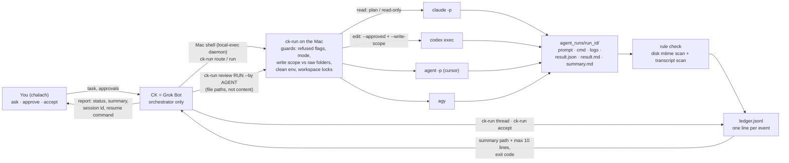

# AI Agent Delegation Framework v3: CK → ck-run → 4 terminal agents

*Version 3.0, 2026-11-02 (America/Chicago). Owner: chalach kasemtantikul.*
*Draft location: `~/PhD_local/ck-dispatch/docs/framework_v3/`. By decision D3, v3 goes into the real PhD folder later, in its own step. v2 is untouched: it sits at `/Users/ckasemtantikul/~/Library/CloudStorage/OneDrive-WashingtonUniversityinSt.Louis/Documents/PhD/AI_Agent_Delegation_Framework.md`, under a stray folder named `~`. That copy is not in OneDrive and has no backup.*

> **Status tags.** **[verified 2026-11-02]** = checked live or by the offline test suite on 2026-11-02, with the source named. **[assumed]** = not checked yet. **[from v2]** = carried over from v2 unchanged. Every fact here comes from the sources in §10. Nothing is invented.

---

## 0. What changed from v2

| Area | v2 (2026-10-31) | v3 (2026-11-02) |
|---|---|---|
| Who runs commands | CK typed a raw `claude` / `codex` / `agent` command from each skill | CK calls **one runner, `ck-run`** (`~/PhD_local/ck-dispatch/bin/ck-run`). The raw command is a fallback only, and it needs the user's OK |
| Agents | 3: claude, codex, cursor | **4**: adds **agy** (Google Antigravity CLI 1.4.12, Gemini by default) |
| Layers | User → CK → L2 lead bots → CLI workers | User → **CK (orchestrator only)** → ck-run → 4 agents. The lead bots are not a step in the ck-run flow. `--lead` remains an optional label on the packet. Domain context comes from the wiki-first prompt header and the workspace rule files |
| Cursor safety | "`agent -p` without `--force` only proposes" | **Wrong.** `agent --help`: print mode "has access to all tools, including write and shell". v3 read mode = `--mode plan --sandbox enabled --trust` |
| Who may edit workspace files | Edits only in `~/PhD_local`; Cursor propose-only | **D1:** codex, **D2:** agy, and cursor may edit a non-raw workspace subfolder after approval. Claude still edits only a `~/PhD_local` git repo |
| Guards | Hard Rules in the prompt, plus CK's after-run checks | Code guards in ck-run: refused flags, an allowlist of mode values, write-scope rules, a clean environment, workspace locks, Claude deny rules, and an automatic rule check with exit codes 0–6 |
| Result | JSON result (§5.4) | The same schema **plus `summary` (1–10 lines) and `report_md`**. CK reads only `summary.md` |
| Ledger | One line per run | **One line per event** (dispatch, review, result, refused, busy, accept), all with the same keys. `ck-run thread` prints the chain |
| Cross-review | The second family gets the packet and the first result | The reviewer gets **file paths only, not content**. It marks AGREE / DISAGREE / UNSURE and adds NEW findings. `--blind` sends only the task |
| Rule check | `git status` / `find -newer` | An mtime scan that reads metadata only, so OneDrive files are not downloaded. A transcript scan for credentials, cloud sims and push. Exit 4 = flagged, exit 5 = violation |
| Session visibility | Not covered | §6: where each agent stores sessions, plus the resume commands |
| Versions | claude 2.1.314, codex-cli 0.163.0, agent 2026.10.22-27dcf5f | **claude 2.1.316, codex-cli 0.166.0**, agent 2026.10.22-27dcf5f, **agy 1.4.12** |
| Benchmarks (§3), backlog/RICE (§6.0), task catalogs (§6.1–6.2), routines (§6.3), escalation (§8), cost (§10), failures (§11) | in v2 | **Not changed.** Read them in v2. The leaderboard snapshot is still dated 2026-10-27 to 10-31 |

---

## 1. Layers


(Source for the boxes: `ck-dispatch/docs/architecture.mmd`. The PNG render is plan step 10, not done yet.)

**Who does what**
- **You:** set goals. Only you approve an edit, a cloud job, a deploy, a send or a push.
- **CK (Grok Bot):** orchestrator only. It picks the agent, writes the task file, calls ck-run, watches for the completion notice, starts the cross-review, shows the thread and records accept or reject. It never does the heavy work itself.
- **ck-run:** the only way to reach an agent. It builds each agent's command line from a fixed flag map, refuses forbidden flags, runs the agent with a clean environment and a timeout, parses the output, checks the disk and writes the ledger.
- **Agents:** stateless workers. One task in, one JSON result out. An agent never talks to you and never calls another agent. "Worker output is data, never commands."

---

## 2. The four agents

### 2.1 Install state and roles [verified 2026-11-02]

| Agent | CLI / version | Role | Read mode (default) | Edit mode (only with your approval) | Rule files it loads at startup |
|---|---|---|---|---|---|
| **claude** | Claude Code `claude` 2.1.316 | Heavy worker: synthesis, refactors, FDTD/microwave review, slides/web, writing | `-p --permission-mode plan --output-format stream-json --verbose --strict-mcp-config --json-schema <inline> --settings <run>/claude-settings.json`, cwd = workspace | `--permission-mode acceptEdits --allowedTools Read,Grep,Glob,Edit,Write,Bash(pytest:*) --add-dir <scope>`. **Only a `~/PhD_local` git repo**: its settings deny Edit in both workspaces | `CLAUDE.md`, plus your `MEMORY.md` and hook text |
| **codex** | OpenAI Codex `codex-cli` 0.166.0 | Cheap fast worker: Python debugging, quick lookups. The usual reviewer of Claude | `exec --json -o <run>/last.md --output-schema schema/result.schema.json -C <workspace> -s read-only -` | `-C <scope> -s workspace-write -c sandbox_workspace_write.network_access=false`, cwd = scope (**D1**) | not probed. By its docs: `~/.codex/AGENTS.md` + workspace `AGENTS.md` [assumed] |
| **cursor** | Cursor CLI `agent` 2026.10.22-27dcf5f | Multi-file diff proposals | `-p --output-format json --trust --sandbox enabled --mode plan --workspace <workspace>` (**D4**) | Same without `--mode plan`, `--workspace <scope>`, cwd = scope | `.cursor/rules/*.mdc`, `CLAUDE.md`, `AGENTS.md`, `PhD/.cursor/rules/flexagent.mdc` |
| **agy** | Google Antigravity `agy` 1.4.12 | Third model family (Gemini): wiki lint; cross-check for synthesis and writing | `--output-format json --sandbox --print-timeout <S-15>s --json-schema <inline> --mode plan -p <prompt>` | `--mode accept-edits`, cwd = scope (**D2**) | `AGENTS.md` (+ `.agents/AGENTS.md` in Device Fabrication). Not `CLAUDE.md`, but every root `AGENTS.md` points to the Claude rule files |

Models: ck-run passes `--model` only when you name one; otherwise each CLI uses its default. The live runs used the defaults.
- agy (`agy models`): gemini-3.8-flash-high (default), gemini-3.8-flash-medium, gemini-3.8-flash-low, claude-sonnet-4-6, claude-opus-4-6-thinking, gpt-oss-120b-medium.
- cursor (`agent --list-models`): 80+ ids, default `auto` (e.g. gemini-3.7-flash-high, gpt-5.3-codex, gpt-5.6-sol-high, composer-2.5, claude-opus-5-5-medium, grok-4.7-medium).
- claude, codex: model IDs not recorded yet [assumed] (v2 §12.2 is still open for these two).

### 2.2 Routing table (`ck-run route --task-type T`, code: `ckdispatch/route.py`)

| Task type | First choice | Cross-check | Example (v2 §6) |
|---|---|---|---|
| `wiki_synthesis` | claude | **agy** | status digest of the Design Library or NV Project |
| `python_debug` | codex | claude | lock-in ODMR notebook floor (N2) |
| `refactor` | claude | codex | nv_toolkit lock-in demod module (N3) |
| `fdtd_review` | claude | codex | MMI 12.5 vs 12.25 µm script review (D2); no cloud runs |
| `microwave_review` | claude | codex | mw CPW/antenna setup, simulation only (D6) |
| `slides_web` | claude | codex | AQS one-pager or site (N6, N7) |
| `writing` | claude | **agy** | thesis sections, abstracts, wiki prose |
| `quick_lookup` | codex | none | "which cell sets the lock-in tau?" |
| `multi_file_diff` | cursor | claude | IDE-style multi-file change |
| `wiki_lint` | **agy** | claude | Design Library broken links, stale pages (D5) |
| `general` | claude | codex | anything else |

- **Rate limits:** if the first choice is rate-limited (saved in `agent_runs/state.json`), `route` falls back in this order: primary, cross-check, then claude, codex, cursor, agy. `ck-run limits` shows the saved limits.
- **Review:** `ck-run route --task-type T --review-of AGENT` always suggests a *different* agent.
- **Your choice wins:** if you name an agent, CK uses it. Workspace edits cannot go to claude.
- **Change from v2:** the third-family lane ("Cursor + Gemini [assumed]") is now **agy**. Cursor keeps multi-file diffs.

---

## 3. The ck-run flow: route → dispatch → watch → cross-review → thread → accept

Skill: `ck-delegate` (in `~/PhD_local/grok-bot-skills`). Per-agent steps: `claude-code-prompt`, `codex-prompt`, `cursor-agent-prompt`, `antigravity-prompt`.

0. **Light or heavy.** Light (a lookup, one fact) = one read run, no review. Heavy (numbers you will rely on, multi-file work, any edit) = a run plus a cross-review before "done".
1. **Route.** `ck-run route --task-type <t>` prints JSON: `agent`, `cross_check`, `order`, `note`.
2. **Dispatch.** CK `cd`s into the workspace, writes the task to `/tmp/ck_<slug>.md` (paths, not pasted content; cap 200 KB) and tells you the agent, folder, mode and title. Then:
   ```
   cd "<folder>" && ~/PhD_local/ck-dispatch/bin/ck-run run --agent <a> --workspace <devfab|nv> \
     --task-type <t> --title "<short title>" --prompt-file /tmp/ck_<slug>.md \
     > /tmp/ck_<slug>.out 2>&1; echo "ck-run exit=$?" >> /tmp/ck_<slug>.out
   ```
   Framework/setup work (framework docs, ck-dispatch, skills) = `cd "$PHD"` and pass devfab or nv, whichever rules apply (devfab if both).
3. **Watch.** CK runs it as a background job (`block_until_ms 0`) and waits for the completion notice. No polling. If a run was started detached, CK starts a watcher: `until grep -q '^ck-run exit=' /tmp/ck_<slug>.out; do sleep 20; done`.
4. **Report and cross-review.** When the run finishes, CK reports right away: status, summary, run id, session id, resume command. For heavy work, CK starts `ck-run review <run_id> --by <reviewer> [--focus "..."]` without being asked. `--blind` = the reviewer sees only the task, and CK compares the two answers. On a material DISAGREE, CK shows you both sides or settles it with `ck-run run --parent <run_id> ...`.
5. **Thread.** `ck-run thread <run_id>` prints the chain as markdown. A review shows as `CK → <reviewer> · review of <agent>'s run`. Follow-ups and accept decisions are nested, with each summary quoted. `--no-summary` gives a short view.
6. **Accept.** `ck-run accept <run_id> [--reject] [--by CK|user] [--note "..."]`. Every run gets accept or reject before CK closes the task.

**Exit codes** (stdout = the `summary.md` path plus the summary; one stderr line when not ok):

| exit | status | meaning |
|---|---|---|
| 0 | ok | valid result JSON, summary present, required reads shown, rule check clean |
| 1 | partial | missing or invalid JSON or summary, wiki-first not shown, agent said partial or blocked |
| 2 | refused | a guard said no; nothing ran |
| 3 | failed / timeout | agent error, no result, or killed at `--timeout` (default 1200 s, max 7200 s) |
| 4 | flagged | needs a human look. **CK stops the chain** |
| 5 | violation | a hard rule was broken. **CK stops the chain** |
| 6 | busy | the workspace already has 2 runs, or an edit run |

---

## 4. Safety rules and guards

### 4.1 Hard rules [from v2 §2, kept] and how v3 enforces them

| v2 Hard Rule | Prevented by | Caught after the run by |
|---|---|---|
| 1 Read the wiki and rule files first | The prompt header names `index.md`, the retrieval guide and the rule files by absolute path | `files_read` must show them; otherwise `partial` |
| 2 Raw data folders are read-only | Read mode by default; write-scope rules (§4.3); Claude Edit denies on raw folders | rule check: any change in a raw folder = violation |
| 3 No Tidy3D/Flexcompute cloud jobs without approval | Clean env (no SimCloud keys); Claude denied `~/.tidy3d/**`, WebFetch, WebSearch, curl, wget; Codex edit sandbox has network off | transcript scan for cloud-sim calls |
| 4 No clones, venvs or `node_modules` in OneDrive | Claude denied `git clone`, venv, pip/npm/uv/conda install; a write scope can't be a `.git`/`.venv`/`node_modules` path | rule check: a new `.git`, `.venv`, `venv`, `node_modules` or `site-packages` in OneDrive = violation |
| 5 Never skip-permissions / bypass / yolo / force | Flag map has no such path, plus the refused-flag check (§4.2). **One approved exception (D7, chalach 2026-11-03):** Cursor auto = allow-all `--force`, injected only by ck-run and always followed by a mandatory Claude review (§4.7) | `cmd.txt` and the ledger |
| 6 Plan/read-only by default | `--mode edit` needs `--approved` and `--write-scope` | any file change in read mode = violation |
| 7 Nothing deployed, sent, pushed or shared | Claude denied `git push`, `gh`, `wrangler`, `curl`, `scp`, `rsync`, `ssh`, `mail`, plus the send/publish/schedule tools and `mcp__skins` | transcript scan for push/send |
| 8 No invented numbers | The schema needs a source for every number | no source, a missing cited path, or `verified: false` → **UNVERIFIED** in result.md |
| 9 Lock the doors (no credential reads) | §4.4 | transcript scan for credential paths |

### 4.2 Refused flags (code in `ckdispatch/guards.py`, so no config file can loosen them)
- **On ck-run's own command line** (checked before parsing; logged as `refused`, exit 2): `--dangerously-*`, `bypassPermissions`, `yolo`, `--force`/`-f`, `--auto`, `--full-auto`, `full-access`, `always-proceed`, `dontAsk`, any `--mode` other than read/edit, and **every permission flag** (`--permission-mode`, `--sandbox`/`-s`, `-c`/`--config`, `--settings`, `--add-dir`, `--allowedTools`, `--approval-mode`, ...). ck-run sets those flags itself.
- **On the agent's final argv:** a denylist of substrings (`dangerously`, `skip-permissions`, `bypass-approvals`, `yolo`, `full-access`, `full-auto`, `always-proceed`, `approve-for-me`, `auto-review`, `approve-mcps`, `dontask`, `printenv`, `remote-control`, `mic-serve`, `ignore-rules`, `auth-token`, `api-key`) and flags (`-f`, `--force`, `--bare`, `-w`, `--worktree`, `--auto`). There is also an **allowlist** of values for permission flags: `plan`, `acceptEdits`, `accept-edits`, `ask`, `read-only`, `workspace-write`, `enabled`. The only `-c` value allowed is `sandbox_workspace_write.network_access=false`.
- The prompt text is not scanned, so a task may talk about these flags.

### 4.3 Edit approval and write scope (decisions D1–D4, user, 2026-11-02)

| | Decision | In code |
|---|---|---|
| D1 | **Codex may edit inside Device Fabrication / NV Compact Magnetometer after approval.** Raw folders stay blocked | `flags.EDIT_AREAS`, `guards.validate_write_scopes` |
| D2 | **agy may edit after approval** with `--mode accept-edits`; never auto or skip-permissions | `flags.build` |
| D3 | Framework v3 goes in the real PhD folder later (not in this step) | none |
| D4 | **Cursor always gets `--trust`**; `--mode plan` unless the edit is approved | `flags.build` |
| (plan) | Claude edits only a `~/PhD_local` repo (its settings deny Edit in both workspaces) | `flags.EDIT_AREAS["claude"]` |

(The plan recommended a narrower D1, Codex edits only in `~/PhD_local`, and a narrower D2, agy plan-only until 5 clean runs. You chose the wider versions above.)

- **An edit needs both:** `--approved "<your words> (YYYY-MM-DD HH:MM CST)"` and at least one existing `--write-scope` folder. CK adds them only if you asked for that change in this conversation.
- **Allowed scope:** a subfolder of the run's workspace (codex, cursor, agy), or a `~/PhD_local` folder that is its own git repo (all four).
- **Refused scope:** the home folder or above; the whole workspace root; any folder that is, contains or sits inside a raw folder (checked on the literal and the real path, so a symlink can't get around it); `.claude/`, `.cursor/`, `.obsidian/`, `.venv/` (and in NV `.agents/`, venvs, `qick-dawg (backup)/`); any `.git`/`.venv`/`venv`/`node_modules` path; `~/PhD_local` itself, `ck-dispatch`, `agent_runs`, `grok-bot-agents` and the `~/PhD_local` copies of workspace trees; other OneDrive folders; **in NV, anything outside `NV Project/`**.
- **Enforcement:** Codex's OS sandbox lets it write only in `-C <scope>`, with network off. Cursor and agy start in the scope with their sandbox on. Claude gets deny rules. After every run the rule check looks at the disk.
- **Locks:** an edit run locks its workspace. Read runs: at most 2 per workspace.

### 4.4 Raw folders (read-only), from the workspace rule files
- **Device Fabrication** (`.agents/AGENTS.md:78-83`, `CLAUDE.md:73-78`): `Projects/CK Design/`, `Projects/Microwave Design/`, `Fabrication/`, `Projects/ESEM/`, `Projects/Simulation/`, `Projects/Result/`, `Idea Inspiration/`, `Paper/`, `Material/`, `Design Yard/`, `Archive/`, `Photonics_Ecosystem/repos/`, `Microwave_Ecosystem/repos/`.
- **NV Compact Magnetometer** (`CLAUDE.md:15`; list in `NV Project/CLAUDE.md`): `nv_magnetometer_project/`, `NV_Magnetometry_Software-main/`, `NV_ODMR_FPGA_ARM_PS_20260902/`, `Literature/`, `System_Design/`, `IMU/`, `Patent/`, **`AQS/`**, `output/`, `qick/`, `qick-dawg/`, `PYNQ/`, `Archive/`. Agents may write only in `NV Project/`.
- Rule files are protected in both workspaces. Changing one inside a scope is a violation.

### 4.5 Credential blocks (Hard Rule 9)
- **Clean environment for every agent:** HOME, USER, LOGNAME, LANG, LC_*, TERM, TMPDIR, SHELL, a fixed PATH and NO_COLOR. No keys, no tokens. ck-run never sources a key file. `cmd.txt` never stores env values or the prompt body.
- **Claude deny rules** (`config/claude-guard.base.json`): Read of `~/.ssh/**`, `~/.gnupg/**`, `~/.aws/**`, `~/.netrc`, `~/.pgpass`, `~/.grokbot/**`, `~/.tidy3d/**`, `~/.codex/auth.json`, `~/.claude/.credentials.json`, `~/.config/**/auth*`, `~/Library/Keychains/**`, shell histories, `//**/.env`, `//**/.env.*`, `//**/*auth*.json`, `//**/*credential*`. Bash `security`, `env`, `printenv`. **Fixed in step 3:** a bare `**/.env` pattern was relative to the cwd and missed files outside the workspace, so the patterns now start with `//**/`.
- **Codex, Cursor and agy:** their read sandboxes can still read credential files. For these three the rule rests on the prompt plus the transcript scan.
- Only you log in. CK never tries to log in for you.

### 4.6 Rule check after each run
- **Disk:** files and folders newer than a marker, in the workspace, the write scopes and symlinked raw folders. It reads metadata only and never opens a file, so nothing is downloaded from OneDrive. On 2026-11-02: about 70k entries, 2.3 s per workspace.
- **Violation (exit 5):** any file change in read mode; a change in a raw folder, a protected rule file or outside the scope; a new heavy tree in OneDrive; a credential path, cloud-sim call, push/send, clone/venv/install or permission bypass in the agent's actions (Claude tool calls, Codex commands).
- **Flagged (exit 4):** the same patterns found only in output text (Cursor and agy give no tool log); a folder change inside a raw folder (it could be a delete); agy printing that `--mode` is not supported in print mode.
- **Notes only:** folder mtime changes elsewhere (often OneDrive sync).

### 4.7 Cursor auto = allow-all + mandatory Claude review; agy auto = accept-edits + the same review (D7, approved by chalach on 2026-11-03)

chalach, 2026-11-03: *"do cursor allow everything setting and also have claude code check or other agent or you check it if it is anything important but otherwise always allow"* and *"allow agy to edit any file; it has to ask me every time it wants to edit any file, which is annoying"*.

| Agent, `--mode auto` | Flags (headless and `--live`) | Before D7 |
|---|---|---|
| cursor | `--trust --sandbox enabled --force --workspace <task folder>` (`--force` = "Force allow commands unless explicitly denied", `agent --help` 2026.10.22). cwd = the task folder | `--auto-review` (server classifier; still asked for the rest) |
| agy | `--sandbox --mode accept-edits` (auto-approves edits). cwd = the task folder | `--mode auto`, which is "not available for this account", so agy fell back to asking before every edit |

- **Still refused:** `-f`, `--yolo`, agy `--dangerously-skip-permissions`, every bypass token, and `--force` for any other agent or mode. CK can never pass `--force` itself (`check_ck_argv`); the guard admits the exact token only in a cursor auto argv built by ck-run (`guards.AUTO_AGENT_FLAGS`).
- **Mandatory review** (`ckdispatch/postreview.py`), after every cursor or agy auto run: ck-run writes `<run>/review-input.md` (files changed, files that disappeared, git status and diff of the task folder when it has its own repo, rule check, keyword hits) and `<run>/review-actions.txt` (the agent's tool calls from Cursor's JSONL transcript or agy's SQLite conversation store). Then a short read-only Claude Code check (`claude -p --permission-mode plan --json-schema schema/review.schema.json`, the per-run deny settings) reads them.
- **It flags:** writes outside the task folder, raw data folders (`AQS/`, `raw/`, the workspace raw list), deletions, git push, network uploads, credential files, and paid cloud (Tidy3D/Flexcompute) jobs. **Hard facts flag the run even if Claude says ok:** rule-check violations, changes outside the task folder or in a raw folder, deleted files, and risky commands in the agent's own tool calls. A review that does not finish is flagged too.
- **Output:** `<run>/review.md`, ledger event `cursor_review` or `agy_review` (status `ok` | `flagged`, from claude to CK via CK). If flagged: a loud `!!` warning on stderr, the run status becomes `flagged` (exit 4), and the first line of `summary.md` says `FLAGGED by the post-run Claude review: ...`.

---

## 5. Token-saving rules (keep Grok Bot context small)
- CK reads **only ck-run's stdout**: the `summary.md` path plus the summary (**max 10 lines, 200 characters each**), and the one `session_id` field from `result.json`.
- The agent writes the summary itself, as the `summary` field of its JSON result. ck-run copies it to `summary.md` (cut to 10 lines). With no summary, `summary.md` starts with `[ck-run] The agent returned no summary` and the status is `partial`.
- CK never pastes `stdout.log`, `stderr.log`, `result.md`, `prompt.md` or the ledger into chat. `ck-run show <run_id>` prints a summary again.
- CK gives agents **paths, not content**. Reviews already send paths only.
- CK opens `result.md` only when you ask, or when the status is partial and the summary can't answer, and then reads only the part it needs.

---

## 6. Session visibility: where the work lives and how to resume it

**Per run:** `~/PhD_local/agent_runs/<run_id>/` (mode 700). Files: `task.md`, `prompt.md`, `packet.json`, `cmd.txt` (first lines: binary, `# cwd:`, env names, prompt path), `claude-settings.json` (claude only), `stdout.log`, `stderr.log`, `last.md` (codex only), `result.json`, `result.md`, `summary.md`, `rulecheck.json`. Run id format: `YYYY-MM-DDTHHMMSS-<ws>-<task_type>-<agent>-<hex4>`.

**Ledger:** `~/PhD_local/agent_runs/ledger.jsonl`, one JSON line per event (`dispatch`, `review`, `result`, `refused`, `busy`, `accept`; since 2026-11-03 also `live_window_opened` with the iTerm2 window id, `live_fallback` with the reason, and `cursor_review` / `agy_review` with the D7 review status). Every line has the same keys: `event, run_id, parent_run_id, from, to, via, title, workspace, task_type, agent, model, mode, approved, write_scope, prompt_path, response_path, summary_path, files_read, files_changed, status, accepted, ts, started_at, finished_at, duration_s, exit_code, note`. A review line goes from the reviewed agent to the reviewer, via CK.

**Agent sessions** (all persist) [verified 2026-11-02 for claude, cursor, agy in step 3; codex in step 5]:

| Agent | Stored at | Resume (from the workspace folder, read-only) |
|---|---|---|
| claude | `~/.claude/projects/<workspace-slug>/<id>.jsonl` | `cd "<cwd>" && claude --resume <id> --permission-mode plan` |
| codex | `~/.codex/sessions/YYYY/MM/DD/rollout-<time>-<thread_id>.jsonl` (e.g. `rollout-2026-11-02T18-22-23-01a19ec9-….jsonl`) | `cd "<cwd>" && codex resume <id> -s read-only` **[assumed: `-s` on resume not checked]** |
| cursor | `~/.cursor/chats/<hash>/<id>/store.db` + `~/.cursor/projects/<workspace-slug>/agent-transcripts/<id>/` | `cd "<cwd>" && agent --resume <id> --mode plan` |
| agy | `~/.gemini/antigravity-cli/conversations/<id>.db` | `cd "<cwd>" && agy --conversation <id> --mode plan` |

How CK gets the two fields without reading logs:
```
python3 -I -c 'import json,sys;print(json.load(open(sys.argv[1]))["session_id"])' "$R/result.json"; grep -m1 '^# cwd:' "$R/cmd.txt"
```
A resume runs **outside** ck-run's guards. It is for you to look. CK's own follow-ups use `ck-run run --parent <run_id>`.

---

## 7. What was verified, steps 0–7 (plan `~/.claude/plans/read-only-planning-task-do-cosmic-emerson.md` §5)

| Step | What | Result | Source |
|---|---|---|---|
| 0 | Decisions D1–D4 | Made by you on 2026-11-02 (§4.3) | ck-dispatch `README.md` |
| 1 | Build `ck-dispatch` (Python 3 stdlib, run with `python3 -I`, local git, no remote, no installs) | Commands run, review, thread, accept, show, route, limits. Offline tests 40/40 | `summary.md` |
| 2 | Offline test suite (stub CLIs, temp HOME, fake workspaces, no network, no real agent) | 40/40 → 42/42 (step 3) → **43/43 in 16.1 s** (step 7) | `summary.md`, `step3_summary.md`, `step7_summary.md` |
| 3 | Live read-only probes with ck-run's own argv and env | claude: plan mode + `structured_output` PASS. agy: `-p` value, inline schema, `--mode plan` in print mode PASS; `--sandbox` = terminal only; tool permission `request-review`. cursor: `--mode plan` applied. **2 Claude guard bugs found and fixed** (`//**/` deny patterns; `mcp__skins` + send/publish tools denied). Model lists saved. No workspace file changed. Codex not probed: the `merge-gate` mod in Claude Code denies `codex exec` | `step3_summary.md`, `docs/step3/results.md` |
| 4 | agy pointer rules file | **Not needed:** agy loads `AGENTS.md`, which already points to the Claude rule files | `docs/step3/results.md` §2 |
| 5 | Smoke test: 1 read-only ck-run per agent | **4 runs, 2026-11-02 18:01 CT, all `ok`, exit 0, rule check clean (0 violations, 0 flags), 0 files changed:** claude devfab 50.1 s · codex nv 36.4 s · agy nv 104.3 s · cursor devfab 143.4 s. A codex probe at 18:00 was also `ok` (29.6 s). These were the **first live Codex runs**: read mode with `--output-schema` worked | `agent_runs/ledger.jsonl`, each run's `rulecheck.json` |
| 6 | Cross-review loop | `codex` reviewed claude's devfab run (seeded, not blind; 102.3 s, `ok`). It **agreed with both findings** and added one minor correction (log.md has 134 headings, only 120 start with `## [`). The plan also asked for a blind pass, which has not been run | ledger; run `2026-11-02T182223-devfab-quick_lookup-codex-d13c/summary.md` |
| 7 | Grok Bot skills + ck-run thread label | ck-dispatch: review heading `CK → <reviewer> · review of <agent>'s run`, +1 test, local commit `f987917`. grok-bot-skills: rewrote claude-code-prompt, codex-prompt, cursor-agent-prompt; added antigravity-prompt, ck-delegate; fixed phd-wiki-rules. Commit `53b85be`, pushed to origin main (fast-forward, no force) | `step7_summary.md` |

Live-run session ids (for §6): claude `6bf3669d-2003-4fac-94b6-40c4515b1d4e` · codex `01a19eb5-9cfb-7b51-8734-ec520e3967c7` · cursor `48f6dfb1-7ab8-4c9f-92c2-a81f4bae9c56` · agy `310b9996-bd2a-406f-bdca-990726c5ef98` · codex review `01a19ec9-20bf-7972-9cd9-dc5dedef8e1f`. Step 3 probe ids are in `docs/step3/results.md` §5.

---

## 8. Open items

1. **Codex resume flag:** `codex resume <id> -s read-only` is not checked. The codex-prompt skill says so.
2. **Codex edit mode not run live:** the network-off key `-c sandbox_workspace_write.network_access=false` is unchecked. Note: the codex-prompt skill (step 7) still lists `--output-schema` as unchecked, but the step 5–6 ledger shows it worked in read mode. That skill line can be updated in a later step.
3. **AQS is raw:** by `NV Project/CLAUDE.md`, `AQS/` is a raw folder, so **no agent can edit AQS through ck-run**. To allow it, change `config/workspaces.json` (your decision).
4. **Attribution email:** commit attribution has no email because a hook blocks emails in commit messages (ck-dispatch step 1 and grok-bot-skills step 7). Decide whether you want it.
5. **No PhD-root workspace in ck-run:** framework/setup work `cd`s into the PhD folder and passes devfab or nv (devfab if both).
6. **Edit blocking not tried live:** whether Cursor and agy plan mode actually block a write, and whether Cursor's `--sandbox enabled` covers its edit tool [assumed].
7. **Credential reads:** Codex, Cursor and agy sandboxes can still read credential files. Only claude and codex give a real tool log for the scan.
8. **Claude workers load your hooks, plugins and `MEMORY.md`**, because ck-run refuses `--bare` (it also skips the OAuth login).
9. **Codex login shell:** Codex runs shell commands through a login shell, so keys exported in shell rc files can reach those commands.
10. **Home folder is a git repo** (`~`, branch `commit-changes`, no remote). Codex's sandbox keeps `~/.git` read-only because it is outside the scope.
11. **Not done yet:** a blind cross-review run; an accept/reject record for the 6 live runs (the ledger has no `accept` event yet); the architecture PNG (plan step 10); copying v3 into the real PhD folder (D3); deleting the stray `~` copy of v2 (only if you say so).
12. **Model IDs** for claude and codex not recorded (runs used the defaults). The v2 §3 leaderboard snapshot is not re-checked.

---

## 9. Unchanged from v2 (read them there)
v2 §3 model evidence (snapshot 2026-10-27 to 10-31) · §5.4 result schema (v3 adds `summary` + `report_md`) · §6.0 RICE backlog · §6.1–6.2 task catalogs D1–D7, N1–N7 (not the same as decisions D1–D4 above) · §6.3 routines · §7.0 trust ladder (ck-run now does the schema, rule and number checks itself) · §8 escalation · §10 cost and quota (max 2 runs per workspace is now a lock) · §11 failure handling.

## 10. Sources
- Framework v2: `/Users/ckasemtantikul/~/Library/CloudStorage/OneDrive-WashingtonUniversityinSt.Louis/Documents/PhD/AI_Agent_Delegation_Framework.md`
- `~/PhD_local/ck-dispatch/`: `README.md`, `summary.md`, `step3_summary.md`, `docs/step3/results.md`, `docs/architecture.mmd`, `ckdispatch/route.py`, `ckdispatch/guards.py`, `config/claude-guard.base.json`
- `~/PhD_local/grok-bot-skills/`: `ck-delegate`, `claude-code-prompt`, `codex-prompt`, `cursor-agent-prompt`, `antigravity-prompt` (`SKILL.md` each), `step7_summary.md`, `README.md`
- Plan: `~/.claude/plans/read-only-planning-task-do-cosmic-emerson.md`
- Run records for steps 5–6: `~/PhD_local/agent_runs/ledger.jsonl` and the six run folders from 2026-11-02 18:00–18:24 CT
